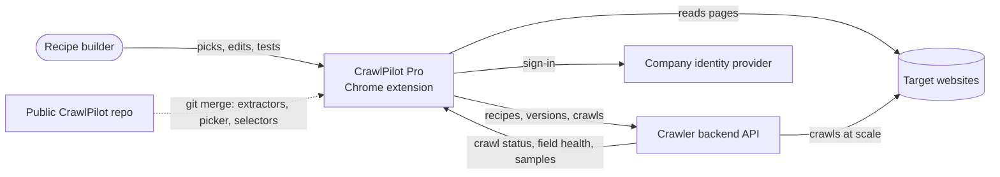
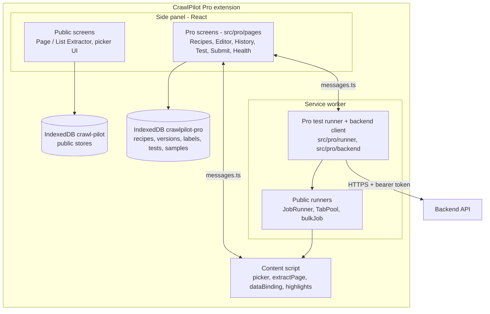

# CrawlPilot Pro: high-level design

Status: 2026-10-25. Draft. Slice 1 (fork and rename) is built; slices 2–5 are designed here.
Companion docs: [LLD.md](LLD.md) (modules, data, algorithms), [REFERENCES.md](REFERENCES.md) (code and docs it builds on).
Plans: [pro-plan.md](../plans/pro-plan.md), [recipe-improvements-plan.md](../plans/recipe-improvements-plan.md).

## 1. Purpose
CrawlPilot Pro is an internal Chrome extension for the team that builds and maintains crawl recipes. A recipe says
what to read from a kind of page (fields, clicks, lists, pagination). Pro is where a recipe is **built, edited,
tested, versioned, submitted** to the crawler backend, and **repaired** when a site changes.

The crawler backend runs every real crawl at scale. Pro extracts data only to test a recipe.

| | Public CrawlPilot | CrawlPilot Pro |
|---|---|---|
| Who | Anyone collecting data | The internal recipe team |
| Output | Tables, exports | Versioned recipes (`.crawlpilot.json`) sent to the backend |
| Runs crawls | Yes, in the browser | Tests only (1 page, or N sample pages) |
| Distribution | Chrome Web Store | Unpacked, or force-installed by Chrome policy |
| Recipe lifecycle | Save and rerun | Versions, labels, tests, submit, health, repair |

## 2. Goals and non-goals
**Goals**
1. A recipe change is never lost or silently overwritten. Every saved version is immutable and numbered.
2. Nothing reaches the backend untested. Submit requires a passing test on sample pages and a passing contract check.
3. The backend and Pro agree on one file: `.crawlpilot.json` (format 2).
4. Repairs are fast: from a failing field reported by the backend to a new live version in a few minutes.
5. Pro stays a thin layer on the public extension. Extractors, pickers and selectors come from upstream.

**Non-goals**
- The backend itself (its queue, browsers, proxies, storage, scheduling engine).
- Large crawls inside the extension.
- AI-written recipes, scripted steps (Lua/JS), getting past bot checks.
- Any thenos code or format. Thenos is a design reference only.

## 3. System context


- **Recipe builder:** an internal user working in Chrome on a live page.
- **Crawler backend:** owned by the backend team. Pro uses its API and does not define its internals.
- **Identity provider:** the company login, through `chrome.identity`. Pro holds a short-lived token only.
- **Public repo:** the `upstream` git remote. Code flows one way, upstream → Pro. Pushes to upstream are disabled.

## 4. Building blocks
Pro is the public extension plus a `src/pro/` layer. The public extension's three runtime parts stay as they are.



| Block | Responsibility | Source |
|---|---|---|
| Content script | Picker, reading a page (`extractPage`, data bindings), highlighting fields | Upstream, unchanged |
| Public extractor screens | Picking fields, lists, clicks, pagination on a live page | Upstream, plus one hook: "Save version" replaces "Run" |
| Pro screens | Recipes library, editor, history and diff, tests, submit, crawls, health, repair | `src/pro/pages` |
| Pro store | Recipes, immutable versions, labels and their log, tests, samples, golden records | `src/pro/db` (own database) |
| Recipe core | Canonical spec, digests, diff, format 2 file, format 1 import | `src/pro/recipe` |
| Test runner | Test on this page; test on N sample pages in background tabs, no table output | `src/pro/runner`, uses `TabPool` |
| Backend client | Typed calls, auth token, retries, error mapping | `src/pro/backend` |

## 5. Main flows
### 5.1 Build and save a version
```mermaid
sequenceDiagram
    actor B as Builder
    participant X as Page/List Extractor
    participant E as Pro Editor
    participant D as Pro store
    B->>X: pick fields, clicks, pagination on a live page
    X->>E: draft (spec, settings, pages)
    B->>E: rename, type, cleanup ops, reorder
    E->>E: change list vs base version
    B->>E: Save version + note
    E->>D: write version N+1 (refused if base is stale)
    D-->>E: version N+1, digest, outputDigest; label latest moves
```

### 5.2 Test before submit
1. **This page:** the side panel sends the version's elements to the content script; each field shows value or "not found" and its step status.
2. **N sample pages:** the service worker opens the samples in pooled background tabs and runs `extractPage` on each. It stores results as a test, never as a table.
3. **Checks:** contract check, golden records (when present), value checks. The result is a test grid (fields × pages).
4. **Ready to submit** = passing test on ≥ 3 pages + contract passing + no required field missing.

### 5.3 Submit and run
```mermaid
sequenceDiagram
    actor B as Builder
    participant P as Pro
    participant API as Backend API
    B->>P: Submit version N (pages, schedule)
    P->>P: gate: ready to submit?
    P->>API: POST /recipes (first time)
    P->>API: POST /recipes/{id}/versions (.crawlpilot.json)
    P->>API: POST /recipes/{id}/crawls (version, pages, schedule)
    API-->>P: crawl id
    P->>P: version locked as submitted; label live moves after the backend accepts it
    loop while the Crawls panel is open
        P->>API: GET /crawls/{id}
        API-->>P: status, counts, fill rates, failing fields, samples
    end
```

### 5.4 Maintain and repair
1. The backend reports field health (fill %, fallback use, failed checks) per crawl.
2. A field that drops below its baseline marks the recipe **needs repair**.
3. **Repair:** open a failing page → the editor loads the live version → failing fields are highlighted → re-pick, test, save N+1, submit, move `live`.
4. **Rollback:** move `live` to an earlier version. One action, logged.

## 6. Data contract: `.crawlpilot.json`
The only thing exchanged with the backend. Versioned with `format`.

- **Format 1** (today's samples in the public repo): one `spec` plus metadata. Pro imports it as version 1.
- **Format 2** (Pro): a recipe with its versions, labels, samples, targeting, requirements, checks, golden records.
  Each version carries `spec` (what to extract, no settings, no URLs), `settings`, `pages`, `output`, `digest`, `outputDigest`.
- The public extension never reads or writes format 2.

Details and the JSON shape are in [LLD.md §6](LLD.md#6-recipe-file-crawlpilotjson-format-2).

## 7. Key design decisions
| # | Decision | Why | Alternative not taken |
|---|---|---|---|
| D1 | Fork of the public repo, Pro code in `src/pro/`, upstream merged regularly | Extractor fixes reach Pro for free; small conflict surface | Shared `@crawlpilot/core` package now (only if syncing starts to hurt) |
| D2 | Own IndexedDB database `crawlpilot-pro` | Versioned recipes have different rules than public `recipes` (immutable, labelled); no schema migration in upstream code | Extra stores in `crawl-pilot` (every upstream migration would conflict) |
| D3 | Immutable versions + movable labels (`latest`, `test`, `live`) | Rollback = move a label; history is never rewritten | A `status` field on the recipe |
| D4 | SHA-256 `digest` over the canonical spec without settings; `outputDigest` over field names + types | Same fields → same digest; consumers know when output changed | Public `specHash` (32-bit, includes settings) |
| D5 | Fixed extension ID via manifest `key` | `chrome.identity` redirect URL and policy install need a stable ID | Random ID per unpacked install |
| D6 | Backend API owned by the backend team; Pro codes against a typed client and a mock | Pro does not block on the backend; contract tests catch drift | Pro defining the backend |
| D7 | Tests run in background tabs and store test results only | Keeps tests separate from public run history and tables | Reusing public jobs and tables |

## 8. Cross-cutting concerns
- **Security**
  - No backend keys in the extension. Sign-in with `chrome.identity.launchWebAuthFlow` against the company identity provider, which issues a short-lived token kept in `chrome.storage.session`.
  - Host access stays opt-in through the existing side panel banner.
  - Pushes to the public `upstream` remote are disabled.
- **Privacy:** pages captured for golden records stay in the Pro store and are sent to the backend only when a version is submitted.
- **Reliability:**
  - Versions are written in one IndexedDB transaction, and a save with a stale base version is refused.
  - Backend calls retry on network errors and 5xx responses, with backoff.
  - A submit is idempotent: the client sends the version digest.
- **Observability:** each test, submit and label move is stored with who, when and why. The Crawls panel shows backend status as the backend reports it.
- **Distribution:** `npm run zip` builds `crawlpilot-pro.zip`. Install it unpacked or by policy. Version numbers start at `0.1.0`.
- **Upstream sync:** `docs/UPSTREAM.md`. After each merge, the full type check, unit tests and e2e suite must pass.

## 9. Delivery: slices
| Slice | Scope | Exit criteria |
|---|---|---|
| 1 ✅ | Fork and rename: own name, icon, ID; public onboarding removed; `src/pro/` | Pro and public side by side; CI green |
| 2 | Recipes and versions, local only: store, import format 1, Recipes screen, Save version, edit → N+1, History + diff, fields panel | Build → v1, edit → v2, diff 1↔2, restore |
| 3 | Test before submit: this page, N pages, test grid, trace, contract, golden records, baseline | "Ready to submit" gate works on local fixtures |
| 4 | Submit to backend: auth, client, submit dialog, Crawls panel, targeting, requirements | Submit to a mock backend; crawl status shown |
| 5 | Maintain: health, needs repair, repair flow, labels for promote/rollback, library filters | A broken field is repaired and promoted end to end on the mock |

## 10. Risks and open questions
| Risk / question | Mitigation / owner |
|---|---|
| Backend API not yet defined | Pro ships against a mock server and a typed contract (`src/pro/backend/types.ts`); the backend team signs off before slice 4 |
| Upstream changes recipe types (`PageSpec`, `ListSpec`) | Pro converts at one boundary (`src/pro/recipe/fromPublic.ts`); type check fails on drift |
| Merge conflicts in hook points | Keep hooks to a few lines; list them in `docs/UPSTREAM.md` |
| Identity provider choice and token audience | Open: backend team |
| Where golden-record HTML lives at scale (IndexedDB size) | Cap per version; move to the backend on submit |
